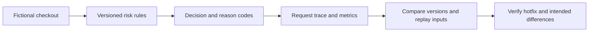

# Reproducing the risk-rule incident

## Execution and attribution

Codex executed this reproduction on October 22, 2026 at the owner's request. The owner personal API walkthrough remains pending. Claude implemented substantial parts of the existing risk, observability and investigation features; their attribution is retained. Codex added the isolated HTTP runner, fresh evidence snapshot and this guide.

[Observed results](../examples/assistant-incident-reproduction.json) include run identifiers, execution timestamps, request traces and replay counts. The runner starts a separate Uvicorn process bound to 127.0.0.1 on an available port and terminates its own server after the run. The request data is fictional.

## Observed HTTP results

| Rules | $180 ordinary checkout | $1,200 checkout |
| --- | --- | --- |
| Baseline 2026.10.1 | approve, score 0 | approve, score 20 |
| Regression 2026.10.2 | review, score 45 | review, score 45 |
| Hotfix 2026.10.3 | approve, score 0 | review, score 45 |

All six requests returned HTTP 200 and were traced to a matching risk_decision log event. Health returned 200 with the expected rules version at each stage. Metrics exposed all three rules versions. This demonstrates why health and HTTP success alone cannot establish correct business behavior.

The regression changes the HIGH_AMOUNT threshold from 1000 to 100 and its weight from 20 to 45. The hotfix restores the threshold to 1000 while retaining the intended 45-point weight. A $1,200 checkout correctly continues to go to review after the fix; a valid fix need not reproduce every baseline decision.



## Fresh replay results

A separate in-process simulation generated 480 fictional decisions with a fixed clock and seed. The observed approval-rate change between traffic phases was -58.3 percentage points. HIGH_AMOUNT drove the change. Replaying identical incident inputs against baseline rules identified 145 blocked decisions that baseline would approve. The hotfix recovered all 145; the recorded rates on those identical inputs are in the evidence JSON.

The phase comparison uses different generated transactions; same-input replay helps isolate the rules' effect. Baseline replay is not independently verified fraud ground truth. Synthetic timestamps and the simulator's fixed 6 ms duration are not wall-clock performance evidence.

## Repeat locally

From the repository root in PowerShell, using Python 3.12:

```powershell
python -m venv .venv
.\.venv\Scripts\python.exe -m pip install -r requirements.txt
.\.venv\Scripts\python.exe scripts/reproduce_incident.py
.\.venv\Scripts\python.exe scripts/simulate_traffic.py --output output/replay-events.log
.\.venv\Scripts\python.exe scripts/investigate_decisions.py --log output/replay-events.log --output output/fresh-investigation.md --verify-fix 2026.10.3 --fix-output output/fresh-hotfix.md
.\.venv\Scripts\python.exe -m pytest -q
```

The HTTP runner writes a unique ignored output/incident-<run-id>/ folder with its report, request log, metrics and server log. Each HTTP run has a fresh directory. The named replay files above are refreshed on rerun; committed examples are preserved. CI executes the HTTP runner and uploads only fresh HTTP result files, not this archived snapshot. Existing tests: 29 passed locally. A dependency deprecation warning was observed; it did not fail the run.

## Owner walkthrough still to perform

Run the commands yourself, inspect a regression request's reason code and trace, compare the old and new HIGH_AMOUNT threshold, and explain why the hotfix restores the ordinary checkout while retaining review for the higher amount. Record your own observation or question before marking the personal walkthrough complete.

## Boundaries

No live customer traffic, fraud-model evaluation, production incident ownership, actual customer escalation or alert delivery is established. The runner verifies metrics exposure, not Prometheus scraping or a five-minute alert notification. CI separately validates the alert rules with promtool. Lab admin controls are for local testing, not production authorization design.
